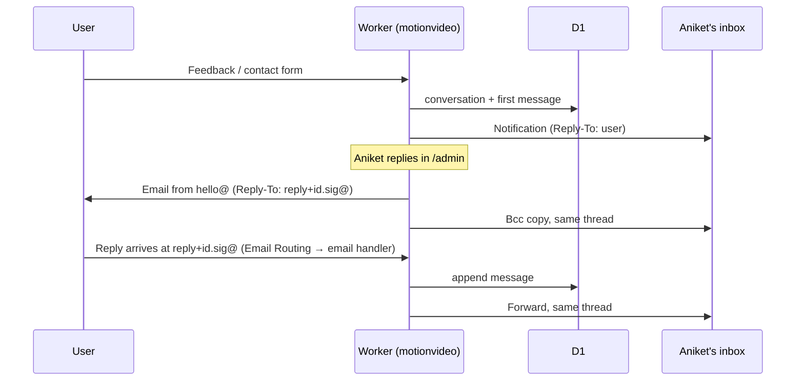

# Email at MotionVideo

How MotionVideo sends email: which provider sends what, from which address, which emails are transactional and which are marketing, the automated sequences, and the rollout. Decisions made so far are marked **Decided**; open ones are listed at the end.

## Where we are

| Piece | Today |
| --- | --- |
| Provider | Resend, one team shared with shadcn-labs.com (Free plan) |
| Resend domains | `shadcn-labs.com`, `motionvideo.xyz` (2 of the 3 the Free plan allows) |
| Sender | Every app email goes out as `"Aniket @ MotionVideo" <hello@motionvideo.xyz>` (`EMAIL_FROM` in `apps/web/wrangler.jsonc`) |
| Code | One seam, `sendEmail()` in `apps/web/src/server/email.ts`; React Email templates in `apps/web/src/emails` (`_layout.tsx`, `sign-in.tsx`, `welcome.tsx`, `pro-launch.tsx`) |
| Inbound | `hello@motionvideo.xyz` (Cloudflare Email Routing to the personal inbox) |
| Contacts | None in Resend yet. 387 accounts in D1 (`user` table), none opted into marketing |
| Settings toggle | "MotionVideo updates" on `/dashboard/settings` is a stub: `useEmailUpdates` keeps it in `localStorage` only |
| Scheduled work | Daily Cron Trigger (`0 3 * * *`, `apps/web/wrangler.jsonc`) runs `scheduled()` in `src/server.ts`, which deletes expired sessions and sign-in codes (`src/server/cleanup.ts`) |
| Pro launch | `pnpm resend:setup` (`apps/web/scripts/setup-resend.mjs`) syncs accounts into the Resend segment "MotionVideo users", uploads `pro-launch.tsx` as the template "MotionVideo Pro launch", and creates a draft Broadcast. Not run yet |
| Account deletion | Self-serve from Settings (`src/server/account-functions.ts`); also deletes the Resend Contact |

## The split

**Decided:** Cloudflare Email Service sends transactional email; Resend sends marketing. Cloudflare can't take everything: its FAQ states Email Service is for transactional email only, no marketing.

|  | Cloudflare Email Service | Resend |
| --- | --- | --- |
| Sends | Everything a user triggers or needs to use their account (see [Transactional](#transactional-emails)) | Everything that is news, promotion, or nurture (see [Marketing](#marketing-emails)) |
| Domain | `motionvideo.xyz` (zone already on Cloudflare) | `updates.motionvideo.xyz` only |
| How the app sends | `send_email` Workers binding, no API key | Resend API (`RESEND_API_KEY`): Contacts, Events, Broadcasts |
| Cost | Workers Paid (already on it): 3,000 emails/month included, then $0.35 per 1,000 | Free marketing plan: 1,000 Contacts (shared with shadcn-labs), 3 segments, 10,000 Automation runs/month |
| What it lacks | Contacts, lists, unsubscribes, templates, campaigns, automations | Nothing needed here; the Free transactional cap (100/day) stops mattering once account email moves to Cloudflare |
| Risk | Email Sending is in beta; new accounts start with a conservative daily quota that grows with good sending | Contact cap is shared with shadcn-labs |

Why:

- **Sign-in codes can never be blocked by marketing.** They leave Resend's 100/day Free cap, and a spam complaint on a promo only touches `updates.`.
- **Domain slots.** Removing `motionvideo.xyz` from Resend leaves `shadcn-labs.com` + `updates.motionvideo.xyz`, one slot spare. Cloudflare allows 30 sending domains per zone.
- **Small code change.** All app email already goes through `sendEmail()`; only its body changes.

## Domains and senders

Two sending domains, not one per email type. Reputation is built from volume and engagement; with ~400 contacts, splitting into four subdomains leaves each one cold. The subdomain protects reputation; the sender name and address carry the relationship. Both fit on one marketing subdomain.

| Email | From | Domain / provider | Reply-to |
| --- | --- | --- | --- |
| Sign-in codes and account email | `MotionVideo <account@motionvideo.xyz>` | Apex, Cloudflare | `hello@motionvideo.xyz` |
| Changelog | `MotionVideo <changelog@updates.motionvideo.xyz>` | `updates.`, Resend | `hello@motionvideo.xyz` |
| Launches, promotions, newsletter, sequences | `Aniket from MotionVideo <aniket@updates.motionvideo.xyz>` | `updates.`, Resend | Aniket's real inbox (open question) |
| Support and contact | `hello@motionvideo.xyz` | Inbound only (Cloudflare Email Routing) | — |

Launches and offers come from Aniket, not from "updates": a person converts better than a brand for a pitch. The changelog comes from the brand because it is news.

Domain settings:

- Open and click tracking **off** on the apex (account email), **on** for `updates.` (marketing analytics).
- DMARC on both. BIMI (logo next to the sender name) needs a paid Verified Mark Certificate; not worth it at this size.

## Transactional emails

Sent through Cloudflare from `account@motionvideo.xyz`. No unsubscribe link (they are not marketing). Plain, branded `_layout.tsx`.

| Email | Trigger | Code today |
| --- | --- | --- |
| Sign-in code | Email code requested | `src/emails/sign-in.tsx`, `src/server/auth.tsx` |
| Purchase welcome + code | Code requested from `/welcome` after a paid order | `src/emails/welcome.tsx`, `src/server/auth.tsx` |
| Business seat invite | Owner invites an email | `src/server/plan-functions.ts` (`inviteSeat`) |
| Job post live / needs changes | Admin review | `src/server/job-functions.ts` (`reviewJobPost`) |
| Sponsorship live / needs changes | Admin review | `src/server/sponsorship-functions.ts` (`reviewSponsorship`) |
| Submission featured | Admin features a community submission | `src/server/submission-admin-functions.ts` |
| Feedback notification (to us) | Feedback dialog | `src/server/feedback-functions.ts`; becomes a [conversation](#conversations-replying-from-admin) |
| Contact form (to us) | Contact page | `src/server/functions.ts` (`sendContactMessage`); becomes a [conversation](#conversations-replying-from-admin) |
| **New:** Reply from MotionVideo | Admin replies to feedback, a contact message, or a submission review from `/admin` | See [Conversations](#conversations-replying-from-admin) |
| **New:** Payment failed | Plan or sponsorship subscription goes `on_hold` | Day 0 and day 3, link to the billing portal (`/dashboard/billing`) |
| **New:** Job post ending | Daily cron, 3 days before `job_post.expires_at` | Renew link |

Plain-text-only notifications (seat invite, reviews, featured) move to React Email templates over time so they share the layout.

## Marketing emails

Sent through Resend from `updates.motionvideo.xyz`. Always include `{{{RESEND_UNSUBSCRIBE_URL}}}`. Authored as React Email templates in `apps/web/src/emails`, uploaded to Resend into a **MotionVideo** template folder (folders are dashboard-only: drag templates in after upload), then edited visually in Resend.

| Email | Sender | Audience | How it goes out |
| --- | --- | --- | --- |
| Changelog | `changelog@` | Topic _Product updates_ | Automatic (see [Changelog](#changelog-automation)) |
| Pro launch | `aniket@` | Segment "MotionVideo free" | One-off Broadcast (`pro-launch.tsx`) |
| Promotion (1–2 a month) | `aniket@` | Segment "MotionVideo free", topic _Tips & offers_ | 3-email sequence (see [Promotions](#promotions)) |
| Newsletter | `aniket@` | Topic _Tips & offers_ | Broadcast, written in the Resend editor |
| Lifecycle sequences | `aniket@` | Triggered per contact | Resend Automations (see [Sequences](#automated-sequences)) |

## Contacts, segments, topics

- **Sync.** Every new account becomes a Resend Contact (on `user.create`, a Better Auth database hook). Account deletion already removes the Contact (`deleteContact()` in `src/server/email.ts`).
- **Segments** (the Free plan allows 3, shadcn-labs uses "General"):
  - "MotionVideo free": accounts without a live plan.
  - "MotionVideo paid": accounts with a live Pro or Business plan or a Business seat.
  - Membership moves when a plan syncs from the Dodo webhook (`src/server/plans.ts`), so buyers never get Pro promos.
  - This replaces the "MotionVideo users" segment `setup-resend.mjs` creates today.
- **Topics** (granular unsubscribe):
  - _Product updates_ (changelog).
  - _Tips & offers_ (newsletter, promos, launches).
  - _Getting started_ (welcome and lifecycle sequences).
- **Settings toggle.** Replaced by the full [notification settings](#notification-settings); topic switches read and write the contact's topic subscriptions in Resend instead of `localStorage`.
- **D1.** `newsletter_subscriber` is unused (no code reads or writes it). Resend Contacts replace it; drop the table and update the privacy page wording.

## Notification settings

**Decided:** every optional email type gets its own switch on `/dashboard/settings` (a _Notifications_ card, laid out like Peerlist's: grouped sections, one row per type with a one-line description, a switch on the right), and the emails that can't be turned off are listed underneath so nobody wonders why they still get them.

| Section | Row | Covers | Default | Stored in |
| --- | --- | --- | --- | --- |
| **From MotionVideo** | Product updates | Changelog emails | On | Resend topic _Product updates_ |
|  | Tips & offers | Newsletter, launches, promotions | New accounts: the sign-up checkbox (unchecked). Existing accounts: on, announced with an opt-out in the first send | Resend topic _Tips & offers_ |
|  | Getting started | Welcome, Pro onboarding, checkout reminder, win-back sequences | On | Resend topic _Getting started_ (each Automation checks it with a condition step before every send) |
| **Your activity** | Submission updates | Your submission was featured or declined, with the reviewer's note | On | D1 |
|  | Renewal reminders | Your job post or sponsorship ends in 3 days | On | D1 |
| **Account emails** (always on, no switch) | — | Sign-in codes, purchase welcome, Business seat invites, job post and sponsorship review results, failed payments, replies to your feedback or messages, changes to the Terms or Privacy Policy | — | — |

How it works:

- **Two stores, one page.** Marketing preferences live in Resend topics, because the unsubscribe link in every marketing email changes them there too; storing them in D1 as well would drift. Activity preferences live in a new D1 table `email_preference` (`user_id` → `user.id` on delete cascade, `key`, `enabled`, `updated_at`; no row means the default). The settings page reads both in one server function and writes each to its own store.
- **Checked at send time.** Every optional transactional email goes through one helper (`wantsEmail(userId, key)`) before `sendEmail()`; account emails skip it.
- **Every optional email links back.** The footer of activity emails gets "Manage email settings" (`/dashboard/settings#notifications`); marketing emails keep Resend's unsubscribe link and add the same settings link.
- **Resend Free plan:** topics don't count against the 3 segments.

## Conversations: replying from /admin

**Goal:** answer feedback, contact messages and submission decisions from `/admin`, and have the user receive it as an email from us that they can reply to, with the whole back-and-forth visible in `/admin` and in Aniket's inbox as one thread.

Today: feedback is stored in D1 and emailed to `hello@`; contact messages are only emailed; replies happen in the personal mail client, so `/admin` never sees them.

- **Data.** New D1 tables:
  - `conversation`: `id`, `kind` (`feedback` | `contact` | `submission`), `user_id` (nullable, set null on delete), `email`, `subject`, `status` (`open` | `resolved`), `created_at`, `updated_at`.
  - `conversation_message`: `id`, `conversation_id` (cascade), `direction` (`in` | `out`), `body`, `message_id` (the RFC 5322 `Message-ID`), `created_at`.
  - Feedback rows link to their conversation; the contact form starts storing messages for the first time.
- **Replying from `/admin`.**
  - Each conversation gets a thread view and a reply box.
  - The reply goes out through Cloudflare from `"Aniket from MotionVideo" <hello@motionvideo.xyz>`. It's a direct reply to something the user sent, so it is transactional.
  - It sets `In-Reply-To` and `References` to the previous message's `Message-ID`, so it threads in the user's client and in Aniket's.
  - A Bcc to `hello@` keeps Aniket's inbox complete.
  - "Reply and resolve" sends and closes in one click.
  - Submissions: "Feature" and "Decline" take an optional note, sent as a reply in the submission's conversation. Today a decline sends nothing.
- **Replies coming back.**
  - Outgoing replies use `Reply-To: reply+<conversationId>.<signature>@motionvideo.xyz`.
  - A Cloudflare Email Routing rule sends `reply+*` to the Worker's `email()` handler, which:
    1. verifies the HMAC signature (keyed with a Worker secret), so nobody can inject messages into another conversation;
    2. parses the MIME (`postal-mime`) and strips the quoted history;
    3. appends the message and reopens the conversation;
    4. forwards the original to Aniket's inbox.
  - Unsigned or unknown addresses are forwarded untouched, never stored.
  - Email Routing is free and unlimited on every Workers plan.
- **Limitation.** A reply written in the personal mail client goes straight to the user and is not recorded in `/admin`. Replying from `/admin` (or adding the `reply+` address in Cc) keeps the record complete.

## Changelog automation

No extra builds, no CI job:

1. A new entry lands in `apps/web/content/changelog/*.mdx` and ships with the normal deploy.
2. The existing daily Cron Trigger checks the newest entry.
3. If Resend has no Broadcast named `Changelog: <slug>`, it renders the changelog React Email template from the entry (title, cover, body, link to `/changelog`) and creates that Broadcast to topic _Product updates_.
4. It is scheduled 24 hours ahead (open question: or left as a draft), leaving time to cancel from the Resend dashboard.

The Broadcast name is the idempotency key, so reruns never send twice and no D1 table is needed.

## Automated sequences

The app sends **events** to Resend; the sequences (emails, delays, conditions) live in Resend Automations and are edited visually there.

| Event | Sent from |
| --- | --- |
| `user.created` | Better Auth `user.create` hook |
| `checkout.started` | `startPlanCheckout` (`src/server/plan-functions.ts`) |
| `plan.purchased` | Plan sync, first live state (`src/server/plans.ts`) |
| `plan.cancelled` | Plan sync, `cancelAtPeriodEnd` turns true or status becomes `cancelled` |

| Sequence | Trigger | Emails | Exit |
| --- | --- | --- | --- |
| Welcome (free) | `user.created` | D0 personal welcome, one first step; D2 best prompts and how to use them; D5 Moves library with a real example; D9 Pro offer | `plan.purchased` |
| Pro onboarding | `plan.purchased` | D0 install the skill and connect MCP; D3 one power tip; D14 "how's it going?" asking for a reply (feeds testimonials) | — |
| Checkout reminder | `checkout.started`, no `plan.purchased` within 24h | One plain email from Aniket: "anything blocking you?" | `plan.purchased` |
| Win-back | `plan.cancelled` | D0 one question, "what went wrong?"; D14 optional offer | `plan.purchased` |

Later: re-engagement for accounts inactive 60+ days (needs a last-active signal; `session.updated_at` is one), sent by the daily cron as a `user.inactive` event.

## Promotions

A reusable 3-email waterfall, run once or twice a month, to "MotionVideo free" subscribed to _Tips & offers_:

1. **Day 0, announce:** what it is, why now, the deadline.
2. **Day 2–3, value and proof:** one concrete example or customer quote.
3. **Day 5–6, last chance:** the real deadline, skipped for anyone who bought in between (they moved to "MotionVideo paid").

Discounts come from Dodo discount codes (`dodo:setup` already manages products).

## Writing principles

From the `coreyhaines31/marketingskills` `email-sequence` skill and standard deliverability practice:

- **One job, one CTA per email.**
- **Subject under ~50 characters, with deliberate preview text.**
- **Personal emails look nearly plain:** no hero images, a short signature with a photo.
- **Changelog** is the only branded, image-led email.
- **Value before ask.** In the welcome sequence, the offer is email 4, not email 1.
- **Real deadlines only.** No fake urgency.
- **Segment by plan.** Paying customers never get Pro promos.
- **List hygiene:**
  - Resend suppresses hard bounces automatically.
  - Stop mailing contacts with no opens in 90 days.
  - Warm `updates.` by sending its first Broadcasts to the most recently active accounts.
- **Cadence:** changelog when it ships, newsletter at most monthly, promos at most twice a month, never two marketing emails on the same day.

## Trust

- **Signature on Aniket's emails:** round photo, name, "Founder, MotionVideo", X handle. A shared `_signature.tsx` for React Email.
- **Testimonials over review sites:**
  - The Pro onboarding D14 email asks for a reply.
  - Happy replies get asked for permission to quote.
  - Quotes go on `/pro` with their X name and avatar, plus a request to post on X.
- **Trustpilot and G2: not now.**
  - G2 is for B2B software buyers comparing vendors, not this audience.
  - A thin Trustpilot profile hurts more than none.
  - Both Trustpilot's guidelines and the FTC's 2024 rule forbid inviting only happy customers.
  - Dodo's reminders are about reviewing Dodo, not MotionVideo.
- **Trustpilot later:** past ~50 paying customers, an automated invite to **every** buyer at day 21, never filtered by sentiment.

## Consent and compliance

- **Existing users never opted into marketing.**
  - The first marketing email (the Pro launch) says what they'll get from now on and links to one-click opt-out.
  - Every marketing email carries the unsubscribe link.
- **New users:**
  - An unchecked opt-in for _Tips & offers_ at sign-up.
  - _Product updates_ on by default, with opt-out in Settings.
- **Privacy page** (`src/routes/{-$locale}/_pages/privacy.content.ts`):
  - Describe Resend Contacts and topics.
  - Describe Cloudflare as a sending processor.
  - Remove the newsletter-table wording.
- **Account deletion** removes the Resend Contact; Cloudflare keeps no contact list.

## Limits

|  | Limit | Matters when |
| --- | --- | --- |
| Cloudflare sending | 3,000/month included (Workers Paid), then $0.35 per 1,000; beta daily quota grows with reputation | Launch days; watch Email Sending logs |
| Resend Free transactional | 100/day | Only until account email moves to Cloudflare. Automation emails likely count here [INFERENCE] |
| Resend Free marketing | 1,000 Contacts across the team, 3 segments | Contacts approaching 1,000 (incl. shadcn-labs): Pro marketing is $40/month for 5,000 |
| Resend Automations | 10,000 runs/month on Free | Not close |

## Rollout

Each phase ships on its own.

**Phase 0: done**

- [x] Daily cron cleanup of expired sessions and codes.
- [x] Self-serve account deletion (incl. Resend Contact).
- [x] `pro-launch.tsx` and `pnpm resend:setup`.

**Phase 1: domains and transactional on Cloudflare**

- [ ] Onboard `motionvideo.xyz` for Email Sending in Cloudflare (same zone, DNS added automatically).
- [ ] Add the `send_email` binding in `wrangler.jsonc` (prod and preview), and switch `sendEmail()` to it.
- [ ] Change the sender to `account@motionvideo.xyz`.
- [ ] Switch on a quiet day; watch sending logs for 24h.
- [ ] Add `updates.motionvideo.xyz` in Resend (tracking on, DMARC).
- [ ] Remove `motionvideo.xyz` from Resend once Phase 1 is stable.

**Phase 2: contacts, consent, notification settings**

- [ ] Segments "MotionVideo free" / "MotionVideo paid".
- [ ] Topics _Product updates_ / _Tips & offers_.
- [ ] Contact sync on sign-up and on plan changes.
- [ ] One-time backfill of existing accounts (rework `setup-resend.mjs`).
- [ ] Settings toggle backed by Resend topics.
- [ ] Opt-in checkbox at sign-up.
- [ ] Privacy page update; drop `newsletter_subscriber`.
- [ ] Topic _Getting started_.
- [ ] `email_preference` table, `wantsEmail()` checks, the Notifications card in Settings, "Manage email settings" footers.

**Phase 3: Pro launch**

- [ ] `pro-launch.tsx` from `aniket@updates.motionvideo.xyz` with the signature.
- [ ] Send to "MotionVideo free".

**Phase 4: changelog automation**

- [ ] Changelog React Email template.
- [ ] Cron step that creates `Changelog: <slug>` Broadcasts.

**Phase 5: sequences**

- [ ] Events from the app.
- [ ] React Email templates for every step, uploaded to the MotionVideo folder.
- [ ] Automations built in Resend.
- [ ] Payment-failed and job-ending transactional emails on Cloudflare.

**Phase 5b: conversations**

- [ ] `conversation` and `conversation_message` tables; feedback and contact form write to them.
- [ ] Thread view and reply box in `/admin`, with "Reply and resolve"; notes on submission feature and decline.
- [ ] Threaded outbound replies through Cloudflare (`In-Reply-To`, `References`, Bcc `hello@`).
- [ ] Email Routing rule `reply+*` → Worker `email()` handler with signed addresses.

**Phase 6: promotions and trust**

- [ ] Reusable 3-email promo templates.
- [ ] Testimonials on `/pro`.
- [ ] Trustpilot invite automation once past ~50 paying customers.

## Open questions

1. Is there a real inbox for `aniket@motionvideo.xyz`, or do replies go to `hello@`?
2. A square photo (≥256×256) and the X handle for the signature.
3. Changelog emails: scheduled 24h ahead automatically, or created as drafts to send by hand?
4. Replies from `/admin`: send as `hello@` with Aniket's name (proposed), or from `aniket@` once that inbox exists?
5. Confirm turning on Cloudflare Email Sending for `motionvideo.xyz` and adding `updates.motionvideo.xyz` in Resend.
